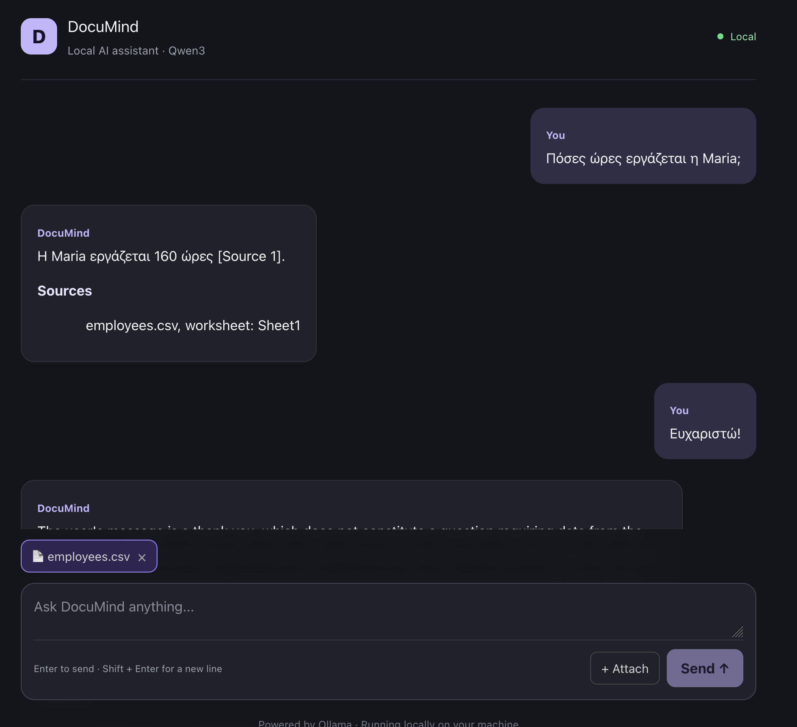
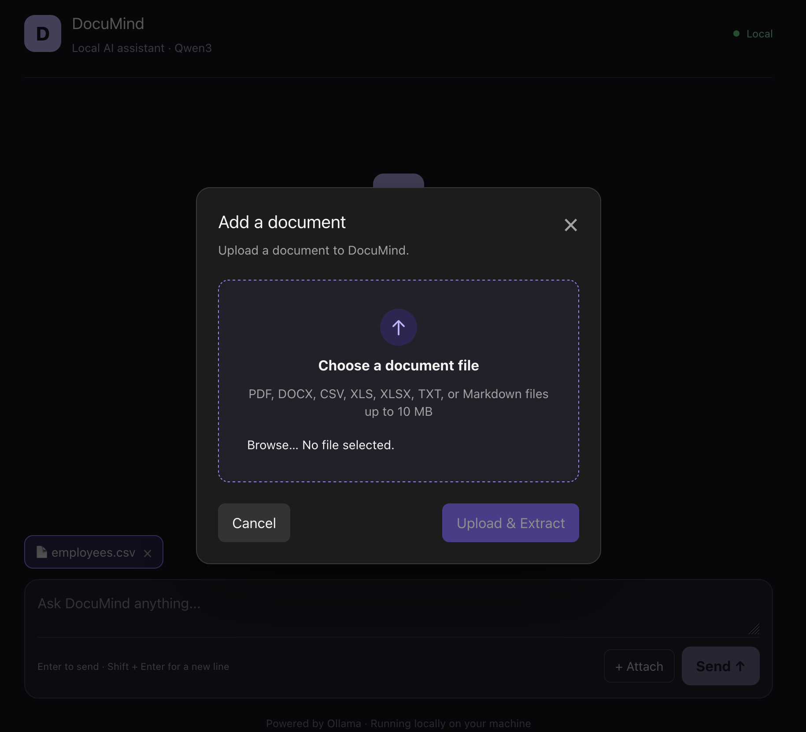

# Frontend

The frontend is a React, TypeScript, and Vite application styled with Tailwind CSS.

## Chat

- Standard chat uses `POST /chat/stream` and appends response chunks as they arrive.
- Document-grounded chat uses `POST /documents/ask` when a document is selected.
- Assistant responses render GitHub Flavored Markdown.
- Fenced code blocks use `react-syntax-highlighter` with the Prism `oneDark` theme.
- The composer and document selector remain available in the sticky bottom area.



*A document-grounded response rendered with a worksheet citation.*

## Documents

The upload modal accepts PDF, DOCX, TXT, Markdown, CSV, XLS, and XLSX files up to 10 MB. After a successful upload, the document is selected for the next question.



*The upload modal showing the supported document formats.*

The app loads saved document metadata through `GET /documents` when it starts. Selecting a document limits RAG retrieval to that document. Removing a document currently removes it from frontend state only; it does not delete the persisted database record.

## Cancellation

The UI supports cancelling:

- Streaming chat requests.
- Document upload and extraction requests.

Cancellation uses `AbortController` on the relevant fetch request.

## Development

```bash
cd frontend
yarn install
yarn dev
```

The API URL is configured through `frontend/.env`:

```dotenv
VITE_API_URL=http://localhost:3001
```

Run frontend validation with:

```bash
yarn build
yarn lint
```
