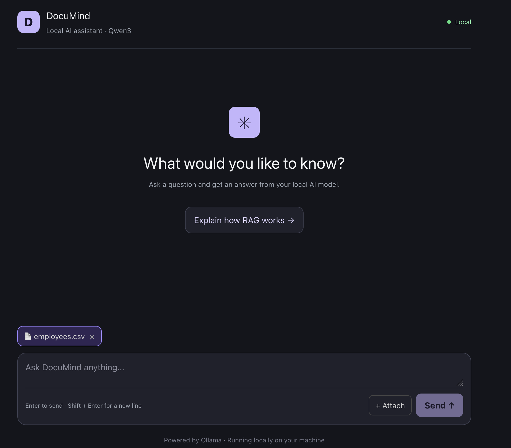

# DocuMind Overview

DocuMind is a local-first AI assistant built with NestJS, React, TypeScript, PostgreSQL, pgvector, and Ollama.

It combines:

- Streaming general chat using `qwen3:4b`.
- Document upload and text extraction.
- Persistent document and embedding storage in PostgreSQL.
- Semantic search using pgvector.
- Retrieval-Augmented Generation (RAG) with source citations.
- Document restoration after a frontend refresh.

*The DocuMind chat interface with the local model status and document composer.*

## Project Status

The core pipeline is implemented: document ingestion, chunking, local embedding generation, persistent PostgreSQL storage, vector search, RAG answer generation, and the React document chat experience.

Current limitations and planned work are tracked in [roadmap.md](roadmap.md).

## Supported Documents

The backend accepts files up to 10 MB with these extensions:

- PDF
- DOCX
- TXT
- Markdown
- CSV
- XLS
- XLSX

Scanned PDFs may require OCR, which is not currently implemented.

## Documentation Map

- [Setup](setup.md): prerequisites, environment variables, database, Ollama, and development servers.
- [Architecture](architecture.md): application components and request/data flows.
- [API](api.md): chat, upload, documents, search, and RAG endpoints.
- [Document Processing](document-processing.md): extraction, chunking, embeddings, persistence, and citations.
- [Frontend](frontend.md): UI behavior, document restoration, Markdown, and cancellation.
- [Troubleshooting](troubleshooting.md): common setup and runtime problems.
- [Roadmap](roadmap.md): completed work, limitations, and next steps.

## Technology

| Area | Technology |
|---|---|
| Frontend | React, TypeScript, Vite, Tailwind CSS |
| Backend | NestJS, TypeScript |
| Database | PostgreSQL with pgvector |
| ORM | TypeORM |
| Local inference | Ollama |
| Chat model | `qwen3:4b` |
| Embedding model | `qwen3-embedding:0.6b` |
| Markdown | `react-markdown`, `remark-gfm` |
| Code highlighting | `react-syntax-highlighter` |
